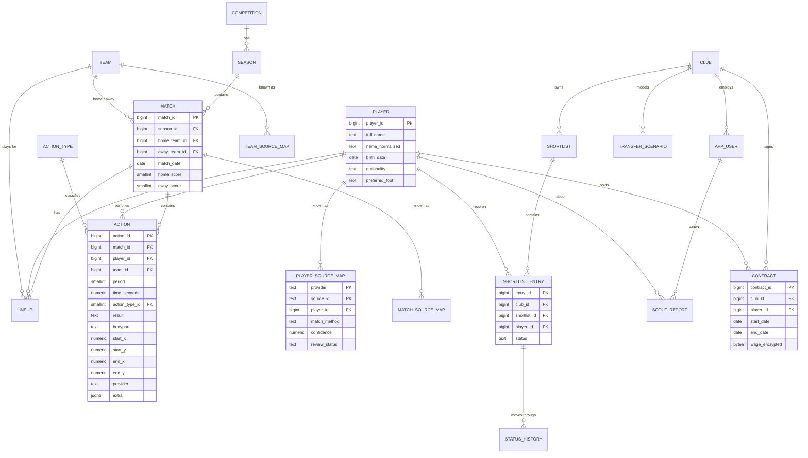

# 02 — Data Model

This is the most important design document in SCOUTBASE. Every later piece (pipeline, warehouse,
app, AI features) depends on it.

## 1. Layers (one PostgreSQL database, several schemas)

```
raw  ──►  staging  ──►  core  ──►  marts
(as delivered)  (cleaned,     (canonical,       (star schema,
                 typed)        provider-free)    analytics-ready)

app    operational, multi-tenant data (shortlists, reports, contracts) — protected by RLS
audit  append-only change log
```

| Schema | Holds | Written by | Rule |
|---|---|---|---|
| `raw` | Provider JSON exactly as received (`JSONB`) + load metadata | Ingestion jobs | Never modified. Lets us replay everything. |
| `staging` | One typed table per provider entity (`stg_statsbomb__events`, `stg_wyscout__events`) | dbt | Rename, cast, deduplicate. No business logic. |
| `core` | The **canonical model**: one definition of player, team, match, action | dbt | Provider-independent. Single source of truth. |
| `marts` | Star schema + aggregates for the app and ML | dbt | Optimised for reading. |
| `app` | What clubs create: shortlists, scout reports, contracts, scenarios | FastAPI | Row-Level Security per club. |
| `audit` | Who changed what, when, old/new values | Triggers | Append-only. |

## 2. The canonical action model (the hard part)

Providers disagree on almost everything:

| Problem | StatsBomb | Wyscout | Canonical decision |
|---|---|---|---|
| Pitch coordinates | 120 × 80 units | 0–100 % on both axes | **Metres, 105 × 68**, origin bottom-left |
| Y axis direction | top = 0 | top = 0 | y grows upwards (math convention) |
| Attacking direction | always left → right per team | always left → right per team | Every action stored **from the acting team's perspective, attacking left → right** |
| Event granularity | pass, carry, pressure, duel, ... | pass, duel, others on the ball, ... | A fixed set of **action types** (pass, cross, shot, dribble, carry, tackle, interception, clearance, ...) inspired by **SPADL** (Decroos et al.) |
| Outcome | per-type fields | tags (`1801` = accurate, ...) | One `result` column: success / fail / offside / own_goal / yellow / red |
| Player IDs | StatsBomb IDs | Wyscout IDs | Our own surrogate keys + **crosswalk tables** |

Things a provider has that the canonical model does not (e.g. StatsBomb 360 freeze frames,
pressure events) are kept in `extra JSONB` — not lost, just not part of the shared contract.

## 3. Entity resolution (crosswalk tables)

There is no shared player ID across providers. Each provider ID maps to one canonical ID:

| Column | Meaning |
|---|---|
| `provider` | `statsbomb` / `wyscout` / `metrica` / `client_upload` |
| `source_id` | The provider's own ID |
| `player_id` | Our canonical ID |
| `match_method` | `exact` (name + birth date), `fuzzy` (normalised name similarity + team + season), `manual` |
| `confidence` | 0–1 |
| `review_status` | `auto_accepted` / `needs_review` / `confirmed` / `rejected` |

Low-confidence matches go to a review queue instead of silently merging two different people.
Same pattern for teams, competitions and matches.

## 4. History: SCD Type 2

A player's team, position and market value change over time. `dim_player` keeps every version:

| player_sk | player_id | team | position | valid_from | valid_to | is_current |
|---|---|---|---|---|---|---|
| 101 | 7 | Farul | LB | 2023-07-01 | 2025-06-30 | false |
| 102 | 7 | FCSB | LB | 2025-07-01 | 9999-12-31 | true |

Facts point to the **version valid on the match date**, so "what was true then" is always answerable.

## 5. Entity–relationship diagram (core + app)



Every `app` table carries `club_id`; RLS policies filter on it using the logged-in user's club.

## 6. Star schema (marts)

| Table | Grain (one row = ...) |
|---|---|
| `fact_action` | one on-ball action |
| `fact_player_match` | one player in one match (minutes, actions, xG, xA, progressive passes, ...) |
| `dim_player` (SCD2) | one version of a player |
| `dim_team`, `dim_competition`, `dim_match`, `dim_action_type` | one entity |
| `dim_date` | one calendar day |
| `agg_player_season_per90` | one player-season, normalised per 90 minutes |
| `player_percentiles` | one player-season, percentiles vs same position |
| `player_embedding` | one player-season style vector (`pgvector`) |

## 7. Key decisions (short ADRs)

| # | Decision | Why | Rejected alternative |
|---|---|---|---|
| ADR-1 | PostgreSQL 16 as the main store | Course fit, RLS, JSONB, pgvector, TimescaleDB all in one engine | MySQL (no RLS), MongoDB (weak joins for analytics) |
| ADR-2 | ELT: load raw JSON first, transform inside the DB with dbt | Replayable, testable, versioned SQL | ETL in Python scripts (logic hidden, hard to test) |
| ADR-3 | Canonical model in metres, attacking left → right | Comparable across providers and with tracking data later | Keep each provider's coordinates (every query must convert) |
| ADR-4 | Surrogate keys + crosswalks | Providers' IDs collide and change | Using provider IDs as primary keys |
| ADR-5 | SCD Type 2 for player and team attributes | Correct "as of match date" history | Overwrite (SCD1): history lost |
| ADR-6 | Separate `app` schema with RLS | Club data isolated at the database level, not just in API code | Filtering by club only in FastAPI (one bug = data leak) |
